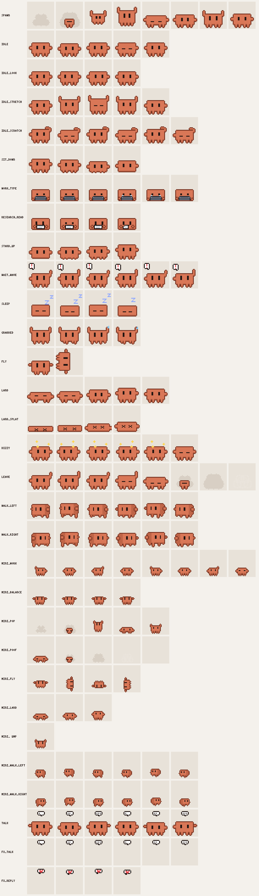
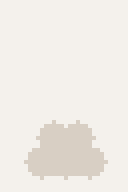

# Character & animation spec

## The buddy

- The buddy is **Clawd**, the Claude Code mascot, drawn pixel by pixel in code (ADR-0013, which supersedes ADR-0005). No official file or image is copied, and there is no Anthropic logo or starburst.
- Look: a block-shaped body wider than tall (20 × 12 px at rest) in terracotta orange `#D97757` with a darker outline `#7A3523` and a shade line along its bottom, two dark vertical slit eyes, an arm nub on each side and four short legs.
- Base canvas **32×32 px** per frame, drawn at integer scale (1x/2x/3x) with nearest-neighbour filtering. Clawd stands on row 29, which leaves room above for bubbles, `z`s and stars.
- Props are separate layers in code, drawn over Clawd: laptop (lid seen from behind, screen light on the cheeks), paper sheet, `!` bubble, `z`s, sweat drop, dizzy stars and dust puffs.
- **Source = code, not `.aseprite`.** `apps/desktop/scripts/gen-buddy-atlas.mjs` draws every frame from rectangles (body, arms, legs) with an automatic outline and shade, then the props, and writes `apps/desktop/src/sprites/buddy/atlas.png` + `atlas.json` (Aseprite "array" JSON, frame tags = animation names). The same run writes the preview sheet `docs/img/buddy/clips.png`, the animated tour `docs/img/buddy/demo.gif` and the app icons in `apps/desktop/src-tauri/icons/`. No image library: PNG through `node:zlib` (`scripts/png.mjs`) and a small GIF encoder (`scripts/gif.mjs`). Each frame is a pure function of its clip and index, so the output is reproducible.
- The overlay checks at startup that every animation it needs exists in the atlas.

## Animations

| Name | Frames (approx.) | Loop | Used for |
| --- | --- | --- | --- |
| `spawn` | 8 | no | Pops in where it stands: a puff, a tiny Clawd springing up, a squashy landing, arms up |
| `idle` | 5 | yes | Slow breathing (3 s loop, the body sinks a pixel for a second) with a quick blink; random extras every 8–20 s: `idle_look`, `idle_stretch`, `idle_scratch` |
| `sit_down` | 4 | no | Transition into working/researching |
| `work_type` | 6 | yes | Sitting, laptop open, typing; occasional screen glow |
| `research_read` | 4 | yes | Sitting, holding a paper sheet, eyes moving; occasional page flip |
| `stand_up` | 4 | no | Leaving a sitting state |
| `wait_wave` | 6 | yes | Standing, waving, `!` bubble bobbing |
| `sleep` | 4 | yes | Curled up, `z` bubbles |
| `walk_left`, `walk_right` | 6 | yes | Every walk, in three-quarter view: the front with the eyes turned towards where he goes, his side in shade behind, diagonal legs trotting together, arms swinging, a slight bob (#85). Back from a throw, up to a freed slot, strolls and visits |
| `talk` | 6 | yes | Standing, gesturing, a `…` speech bubble: visiting another buddy |
| `fx_talk`, `fx_reply` | 6, 4 | yes | Bubbles alone (`…`, and a heart in reply), drawn over a buddy without changing its pose |
| `grabbed` | 4 | yes | Dangling, legs kicking |
| `fly` | 2 | yes | Tumbling in the air |
| `land` | 5 | no | Squash on landing; hard landings play `land_splat` then `dizzy` |
| `dizzy` | 6 | no | Stars circling, then shakes it off |
| `leave` | 8 | no | Waves goodbye, crouches and vanishes in a puff; the last frame is empty |
| `mini_work` | 8 | yes | A mini Clawd (a subagent) on the stack: arms pumping in turn, a blink. 250 ms frames |
| `mini_balance` | 4 | yes | A mini riding a buddy that walks or is held: arms out, swaying |
| `mini_pop`, `mini_poof` | 5, 5 | no | A mini popping in from a small puff, and vanishing in one; the last poof frame is empty |
| `mini_fly`, `mini_land`, `mini_jump` | 4, 3, 1 | yes, no, yes | A scattered mini tumbling, landing, and hopping back onto the stack |
| `mini_walk_left`, `mini_walk_right` | 6 | yes | A mini walking back, in three-quarter view like Clawd |

### State → animation

| Buddy state | Enter | Loop |
| --- | --- | --- |
| `spawning` | `spawn` | then `idle` |
| `idle` | `stand_up` if sitting | `idle` (+ random extras) |
| `working` | `sit_down` if standing | `work_type` |
| `researching` | `sit_down` if standing (swap prop if already sitting) | `research_read` |
| `waiting` | `stand_up` if sitting | `wait_wave` |
| `sleeping` | — | `sleep` |
| `leaving` | `stand_up` if sitting | `leave`, then removed |

Animation playback is driven by an **animation controller** per buddy: target state comes from the registry; the controller plays the needed transition before the loop, and never interrupts a non-looping clip except for `grabbed`.

Implemented in `apps/desktop/src/overlay/controller.ts`:
- Posture decides the transition: `sit_down`, `work_type` and `research_read` leave the buddy sitting, everything else standing.
- A new buddy always plays `spawn` first, even if it is first seen mid-turn.
- A state that arrives during a non-looping clip (transition, `spawn`, idle extra) is applied when that clip ends. Changing your mind mid-transition plays it out and comes back (e.g. `sit_down` then `stand_up`).
- `leave` plays once and holds its last frame until the session is removed.
- Idle extras (`idle_look`, `idle_stretch`, `idle_scratch`) start 8–20 s into each `idle` loop, picked at random. They are deadlines the render loop sleeps until, not timers. Reduce motion turns them off.
- Clips follow each other at exact times, so what shows depends only on the timestamps, not on how often the overlay redraws.
- **Out of step:** each buddy starts its loops at its own phase (a hash of its session id picks the frame it starts on), so buddies that appear together do not breathe, blink and type in lockstep.
- **Shared timing grid:** a loop's frame changes fall on multiples of its grid (the longest time every frame lasts a whole number of) on one clock, whenever the buddy started, and idle extras start on the idle loop's grid. See [Redraws](#redraws).
- **Back from an excursion** (throw, stroll, visit), where it stood and walked, the controller plays the way into the current state again from standing: a working buddy sits back down instead of popping into its chair.

## Layout

- Buddies stand side by side on an invisible "floor" in the chosen corner, 4 px gap, newest at the outer edge.
- Max 10 visible; extras collapse into a `+N` chip that expands on hover.
- A buddy in `waiting` steps 4 px forward so it stands out.
- Slots are stable: a buddy keeps its slot until it leaves.

Implemented in `apps/desktop/src/overlay/layout.ts` and `scene.ts`:
- **Order:** creation order, oldest touching the corner, mirrored for left and top corners; "forward" means away from the screen edge.
- **Leaving:** when a buddy leaves, the ones behind it walk up one slot at 64 sprite px/s, facing the way they go (`walk_left` / `walk_right`). Positions are kept in sprite pixels along the floor, so resizing the window or changing DPI never makes anyone walk.
- **Overflow:** the 10 oldest stay visible and the newest go behind the chip. Hovering the chip shows everyone; the group collapses 1.5 s after the pointer leaves it. Hidden buddies reappear in place, without walking.
- **Window size:** the overlay window resizes around the group from its corner (`set_overlay_content_size`), instead of keeping a fixed size. It always keeps room for the hover balloon (280 × 62 CSS px plus its tail), so opening the balloon never resizes the window.
- **Hit regions:** only Clawd's part of each 32×32 frame (28 × 21 sprite px, arms up included) takes the mouse, so the empty air above him stays click-through.

## Strolls

Now and then an idle buddy goes for a short walk along the floor, away from the corner, looks around and walks back.

Implemented in `apps/desktop/src/overlay/excursion.ts` (`Stroll`, pure) and `scene.ts`:
- **When:** the first stroll comes 30–90 s after a buddy turns idle, the next ones every 1–3 min. Only one buddy is out at a time, and after any stroll the whole group stays home for 45–90 s, so a big group is not always on the move. Never the one under the pointer, never while it plays an idle extra, and never with reduce motion on.
- **How:** 40–120 sprite px towards the screen centre at 40 sprite px/s with `walk_left` / `walk_right`, a 1.2–2.8 s look around (`idle_look`), then back to its slot (following it if it moved).
- **Called back:** if its session gets work meanwhile, it turns around at once, walks back and sits down.
- **Window:** while someone strolls, the overlay grows to a strip along the floor (`overlay_expand` with `"floor"`: the work area's width, the corner area's height) and shrinks back when everyone is home.

## Subagents

Each running subagent shows as a mini Clawd standing on its session's buddy, stacked in start order with the oldest at the bottom (docs/session-detection.md#subagents).

Implemented in `apps/desktop/src/overlay/minis.ts` (`MiniStack`, pure) and `scene.ts`:
- **Look:** a mini is drawn at the same pixel size as Clawd and about half as big (a 10 × 6 body), in a 32 × 32 frame of its own.
- **Stack:**
  - The first mini's feet stand on the buddy's head, and each next one stands on the head below it.
  - Each atlas frame says where the head is: a `head` row, not one of Aseprite's own fields, which the generator computes from the body's pixels. So the stack follows the buddy as it breathes, sits, stands, stretches or hops.
  - At most 5 minis show. The buddy's balloon counts every subagent ("3 subagents working").
- **Coming and going:**
  - A new subagent's mini pops in on top of the stack (`mini_pop`), then works (`mini_work`).
  - A stopped one vanishes in a puff (`mini_poof`), and the minis above it drop a level in 140 ms.
  - The buddy leaving takes them all.
- **Riding:** the stack stays on the buddy while it walks to a freed slot, strolls, visits or is held, and the minis balance (`mini_balance`).
- **Thrown:** when the buddy is let go, the minis fly off and scatter. Each gets 60 % of the buddy's speed plus a random push, up to 260 CSS px/s sideways and 350–700 CSS px/s up (at 2×). Each then flies with the same physics as Clawd, lands (`mini_land`) and walks back at 48 sprite px/s (`mini_walk_left` / `mini_walk_right`).
- **Same order, always:**
  - Back from a throw, the minis wait in a line beside the buddy's slot, away from the corner, in stack order.
  - Once the buddy is home again, they hop back on one at a time, bottom first: a 360 ms hop with an 8 sprite px arc (`mini_jump`).
  - A mini whose turn has not come waits, even if it got back first. A subagent that starts meanwhile queues behind them.
  - The overlay stays grown to the work area until every mini is back on the stack.
- **Hover and click:** each mini has its own hit region (14 × 11 sprite px).
  - Hovering one opens a balloon about its subagent: what it does ("Running cargo"), then its type, the project and for how long ("general-purpose subagent · claude-buddy · 3s").
  - The buddy's own balloon goes over the whole stack.
  - A click on a mini focuses its session's terminal. A drag on a mini picks up its buddy.
- **Window:** the overlay keeps room for the tallest stack above the group: 9 sprite px per mini beyond the first.

## Sessions talking to each other

When a session messages another (docs/session-detection.md#sessions-talking-to-each-other), the sender's buddy walks over to the recipient's, they chat, and it walks back.

Implemented in `excursion.ts` (`Visit`, pure) and `scene.ts`:
- **Visit:** a sitting sender stands up first (`stand_up`), walks beside the recipient on its own side (`walk_left` / `walk_right`), talks for 2.6 s (`talk`, a `…` bubble), and walks back. 0.9 s into the talk, a heart bubble (`fx_reply`) answers over the recipient.
- **Bubbles only:** when the walk cannot be shown (the recipient is unknown or gone, either buddy is away or hidden behind the chip, or reduce motion is on), a `…` bubble (`fx_talk`) shows over the sender for 2.6 s instead, with the heart over the recipient if known. A new bubble over a buddy replaces the one it would overlap.
- Visits stay inside the corner area, so the window does not grow for them.

## Interactions

| Input | Behaviour |
| --- | --- |
| Hover (300 ms) | Speech balloon above the buddy: what it is doing in plain words, project, state and for how long, "approximate" hint for transcript-only sessions |
| Click | Focus the session's terminal window; buddy does a small happy hop |
| Double-click | Buddy does a random silly animation (spin, jump) |
| Drag | `grabbed`; buddy follows the cursor with a little lag (spring) |
| Release with velocity | `fly` with gravity (≈ 2000 px/s²), bounces off screen edges (restitution 0.4), friction on floor; `land` / `land_splat` → `dizzy` on hard landings; then walk back to slot and resume state. Its minis scatter and come back (see [Subagents](#subagents)) |
| Release without velocity | Drops, `land`, walks back |
| Right-click | Context menu: Focus, Copy session id, Hide this buddy |

While a buddy is held or in the air the overlay temporarily grows to the monitor's work area and shrinks back once it is in its slot again.

### Drag and throw

Implemented in `apps/desktop/src/overlay/throw.ts` (physics and phases, pure), `scene.ts` and `expand.ts`:
- **Click or drag:** a press on a buddy that moves more than 4 CSS px is a drag; one that stays put is a click (focus, see above). Drags only start on a buddy's hit region.
- **Held:** `grabbed` loops; the buddy hangs from the point where it was caught and follows the pointer on a critically damped spring (stiffness 600/s²), so it lags a little without wobbling.
- **Thrown:** on release it keeps the spring's velocity (capped at 4000 px/s) and plays `fly`: gravity 2000 px/s², bounces off the work-area edges with restitution 0.4, and on the floor a bounce slower than 60 px/s settles and friction (1600 px/s²) slides it to a stop. A release without velocity just drops.
- **Landing:** `land`, or `land_splat` then `dizzy` when the first floor impact was at least 1400 px/s (a fall of about 490 px). Then it walks in a straight line back to its slot at the normal walking speed, facing the way it goes (`walk_left` / `walk_right`), following the slot if it moves meanwhile, and goes back to its session's animation, which kept running underneath.
- **Physics:** fixed 120 Hz steps on a grid that starts at the grab, in CSS px relative to the group's corner area, separate from drawing. The path depends only on the input timestamps, not on the redraw rate. The render loop runs at frame rate only while someone is held, flying or walking back, and sleeps again after.
- **Window:** on the first drag the backend expands the overlay to the work area (`overlay_expand` returns where the corner area sits inside it), so the group stays put on screen while the window grows; it is drawn in that area whenever the canvas has the expanded size. Everything outside the buddies stays click-through. When the last buddy is back in its slot, `overlay_restore` shrinks the window again. Until the expansion lands, a throw stays inside the corner area.
- A buddy can be caught again in mid-air, or while it strolls or visits. The hover balloon does not open on a thrown buddy.

## Hover card content rules

- Max 3 lines, 80 chars each, sanitised (no secrets, no full commands). Example:
  - **`Editing physics.ts`**
  - `claude-buddy · Working 2m 14s`
- The balloon is the only clickable-through exception besides the buddies.

Implemented in `apps/desktop/src/overlay/hoverCard.ts` (text, timing, placement) and `renderer.ts` (drawing):
- **Lines:** what the buddy is doing in plain words (bold), then `<project> · <state label> <elapsed>`, then "Approximate: connect Claude Code for exact states" for transcript-only sessions. While working or researching, the first line describes the current tool and its target: "Editing app.ts", "Reading README.md", "Searching for fn main", "Running pnpm", "Searching the web for …", "Delegating to Explore", "Messaging researcher", "Using github: create pull request". Otherwise it describes the state: "Done, waiting for a prompt", "Waiting for you", "Thinking", "Sleeping", and so on.
- **Look:** a pixel-art speech balloon matching the sprites: white, a 1-sprite-pixel dark outline with cut corners, a soft shadow, a stepped tail pointing at Clawd's head, and a coloured dot for the state (orange working, blue researching, red waiting, green idle, purple sleeping). At most 280 CSS px wide; longer lines end with `…`.
- **Sanitising:** lines are cut to 80 Unicode code points with `…`, and control characters are replaced, a second barrier after the backend's sanitising.
- **Timing:** the balloon opens after 300 ms on one buddy and stays open while the pointer is on the buddy or the balloon. The elapsed time redraws once per second, only while it is open.
- **Placement:** centred on Clawd, on the side away from the screen edge (above in bottom corners), inside the overlay. While open, the balloon and its tail down to the buddy are one hit region, so moving onto it keeps it open.
- **On Windows:** the overlay is click-through until the mouse hook sees the pointer over a region. The backend's `overlay:pointer` event then says where the pointer is (`{ inside, x, y }`), so the balloon starts its delay even before the page gets a mouse event of its own; and when the pointer left every region, which closes it 120 ms later unless the pointer is still there. The window never resizes for the balloon, and the hit tester keeps regions where they are on screen while the window grows or shrinks around its corner (until the page sends new ones), so the pointer never seems to leave a buddy just because the window changed size.

### Click

- A click on a buddy asks the backend to focus its session's terminal (docs/session-detection.md#window-focus-click-on-a-buddy). Clicks on the hover balloon do nothing.
- **Happy hop:** when the window came to the front, the buddy hops 6 sprite px away from the floor and back in 320 ms (a parabola, whole sprite pixels), over whatever clip it is playing, sitting or standing, so no extra art is needed. The hit region and the hover balloon stay in place during the hop. No hop when nothing was focused.
- In `pnpm dev:mock` there are no terminals, so every click hops.

## Redraws

The overlay draws only when a frame changes: the render loop sleeps until the scene's next change (`nextChangeAt`), with no polling and no repeating timer.

- **At rest** (idle, working, researching, waiting, sleeping, with or without idle extras), every frame lasts a multiple of 125 ms (`idle` breathes in 1 s frames with a 125 ms blink, `sleep` 500 ms). The controller puts loops on one shared clock, so all buddies change frames on the same 125 ms steps: a resting group redraws at most 8 times a second however many buddies there are.
- **Only when the picture changes:** when the atlas is generated, a frame that looks the same as the one before it is merged into it (a longer frame), so a buddy holding a pose does not cause redraws. Measured over a simulated minute: one idle buddy redraws about twice a second, three about 4 times, eight about 7; a sleeping group twice; a working one 8.
- **Minis** on a stack change frames on the same clock (`mini_work` every 250 ms), so a stack adds at most 4 redraws a second.
- **Walking** (strolls, visits, walking up to a freed slot): 20 redraws a second, only while someone walks.
- **Held, flying or hopping** (buddies and scattered minis): 30 a second, only while that lasts.
- A frame change is never asked for at the current instant, so rounding cannot make the loop draw the same frame twice.
- One-shot clips (`spawn`, transitions, `leave`) start when their event arrives and run at their own frame times.

## Accessibility & comfort

- Option to reduce motion (no random idle extras, no strolls, chats shown as bubbles only, no screen shake), in the settings window; it applies at once, also to buddies already on screen.
- `waiting` uses shape (bubble + wave), not only colour.
- Tooltip text respects system font scaling.
